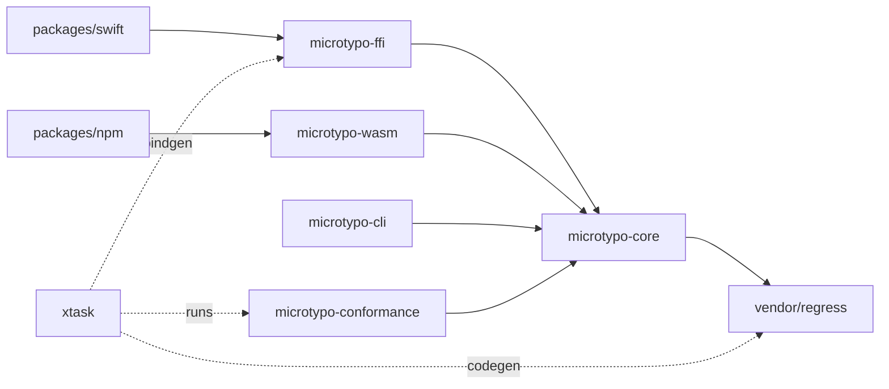

# Architecture

## Invariant

For any input and configuration, the engine returns the reference implementation's output, `changes`, `edits`, `trace` and errors (`name`, `message`, `code`, `details`) byte for byte. Text and coordinates are UTF-16 code units. `testdata/conformance/corpus.jsonl` holds the reference behaviour as cases and `corpus.sha256` pins its source commit and digest; the core and the npm package replay it.

Known divergences:

- A lone surrogate in the `message` or `details` of an error is rendered as U+FFFD.
- `maxProcessingMs` also holds inside a regex search, so a stage the reference runs past the budget and only then reports ends here as soon as the budget is spent, with the same error.
- Under `u` or `v`, a search from an index between the halves of a surrogate pair starts at the pair, as in V8 (`/./uy` from 2 in `a😀b` matches 1..3), but never tries the index itself: `/\B/uy` and `/(?<!a)/uy` from 2 and `/\B/gu` find an empty match at 2 in V8 and none here. regress reads the low half as a lone surrogate, so an attempt there would accept matches V8 rejects (`/(?<=[^a])/uy` from 2). No built-in expression in the corpus or the fuzzer needs a match between the halves.

## Layout

| Part | Role |
|---|---|
| `crates/microtypo-core` | engine: rules, input formats, markup protection, budgets; `forbid(unsafe_code)` |
| `crates/microtypo-ffi` | C ABI, header in `include/microtypo.h`; the only workspace crate with `unsafe` |
| `crates/microtypo-wasm` | `wasm-bindgen` boundary |
| `crates/microtypo-cli` | `microtypo` binary: the reference CLI over the core; not part of the release set |
| `crates/microtypo-conformance` | replays corpus cases against the core for the conformance test and, as a JSONL filter, for the fuzzer, `parity` and `matchers` |
| `packages/npm` | `@meritt/microtypo-wasm`: JavaScript API over the module |
| `packages/swift`, `Package.swift` | Swift package `MicroTypo` over the XCFramework |
| `vendor/regress` | ECMAScript regex engine over UTF-16, prefilter, matcher generator |
| `xtask` | header, builds, release set, corpus copy, parity guard, CLI comparison, matcher generation, differential fuzzer, benchmark |

Bindings depend on no workspace crate but the core. Core tests are `tests/behaviour` (library behaviour), `tests/growth` (linear scaling and timing), `tests/conformance.rs` and `tests/matchers.rs`.

## Core

- Names and option spellings follow the reference, hence the relaxed naming and size lints in `Cargo.toml`. Inputs below the limits keep every `usize`/`u32`/`f64` cast exact, hence the allowed `cast_*` lints.
- Text is `JsString` (UTF-16 units); lone surrogates survive everywhere, including rule-group names, rule ids, trace names and cycle-hook ids, which have one canonical UTF-16 form that metadata JSON quotes without replacement.
- `js` reproduces the JavaScript semantics the engine relies on: ECMAScript regexes, `JSON.parse`/`JSON.stringify` with V8 error messages, insertion-ordered config objects.
- One `Error`; `ErrorKind` is `Config`, `Input`, `Budget` or `Type` (`MicroTypoConfigError`, `MicroTypoInputError`, `MicroTypoBudgetError`, `TypeError`). Bindings map it without changing fields.
- Limits: `maxInputLength` (default 30 000 units) before processing; `maxProcessingMs` at the reference's check points (between stages, after each rule, pre-parse hook and cycle iteration, after restoration) and inside regex searches; `MAX_ENTRIES` (100 000) per vault. The interpreter and the generated matchers read the clock once per 65 536 backtracking steps; past the budget the search fails and its later attempts fail, and the next stage check raises `MicroTypoBudgetError` with that stage's label. The sequence scanners in `protect/sequences.rs` check the same budget state every 65 536 units.
- The core performs no I/O. Its two effects, the clock and the random bytes, come from the `Host` each constructor takes: two plain functions, so the regex budget can keep the clock in a thread-local. The final binary picks the `getrandom` backend and the allocator. Each binding tests that a catastrophic input ends with `MicroTypoBudgetError`.
- Placeholders of vaulted URLs, addresses, tokens and tags carry a nonce from the host's CSPRNG, drawn from a 256-byte pool filled on the first `process` call that needs one, never at construction. A host without entropy panics rather than mint a guessable nonce. Placeholder-shaped text is stripped on entry, and a custom group's output holds no placeholder token more often than its input.
- A builtin rule declares the characters (`requires`, `requiresAny`) and expression (`requiresPattern`) its text must contain, as `lib/rule-features.js`. While every registered group is builtin and no cycle hook is set, the runner skips a rule whose text lacks them, and a structured value skips the pipeline as `canSkipValue` decides (after one budget check labelled `data-value`). The skip is observable: a rule that runs on a run with nothing to lift still settles the lifting and records a trace event, which moves later trace ranges.
- The character mask of a text is reused only while the runner knows the text is unchanged; after a handler it is recomputed or matched by content, since a handler may rewrite its buffer in place.
- A pass whose replacements all equal their matches returns its input and builds no text; replaced text goes back to a per-thread spare buffer (`js::regex::recycle`). Because buffers are recycled, a cache keyed by buffer address (the no-wrap context, the quote session) is valid only until the next pass of a rule.
- State the reference keeps per run in module scope (boundary activity, quote padding, space collapse, quote paragraphs, inline tag names) lives in `Ctx::bound`, set by the engine and the runner.
- Attribute values (`input.attributes`) and HTML `<title>` bodies are typeset by worker engines: format `plain`, or `text` for a title body holding a tag or comment. A worker is built on first use, kept between calls with per-call state reset, rebuilt when `maxProcessingMs` changes, and takes the outer engine's groups, order, settings and cycle hook on each use; vaults read so far are passed in so their tokens stay inherited.
- With `presets: false` nothing compiles the built-in groups; Miri depends on it.

## Public surface

- Modules are private; the crate root re-exports what a Rust caller and the bindings use, and `cargo doc` shows only that. The surface is checked by `cargo semver-checks` in CI.
- `process(&str)` returns `Cow<str>`, borrowing the input when no rule changes it; `process_utf16` takes and returns UTF-16 for callers that hold it. `process_with_options` takes the reference `process` options object and returns `Output::Text` or `Output::Diagnostics`.
- Diagnostics (`changes`, `edits`, `trace`) are selected independently. Source maps ride on the existing restore owners, inline positions and seal/unseal boundaries; nonce text is never diffed against authored text; rejected attempts and structured-value rollbacks discard their events. Processing without diagnostics allocates no maps.
- `from_json` and `call_json` read JSON through `RawJson`, which keeps original string units (escaped lone surrogates) beside the structure serde validates; names, pattern sources, replacements and selectors come from the raw side. The CLI merges configuration through the same reader. There is no second JSON or regex parser.
- Data rule groups (`pattern: { source, flags }`, string replacement) compile through the same `Re` and run under the same budgets as native rules.
- `Config` reading runs the engine's validation, so a bad config fails with the same `MicroTypoConfigError`.
- The conformance replay, the tests, the parity guard and the benchmark reach internals through one `#[doc(hidden)] internals` module; helpers that rules use (`Re::new`, `Caps::s`, `lit!`, `cat!`) are hidden the same way. A cargo feature would not hide them: features unify across the workspace, and `cargo doc --workspace` would still show them.

## Regular expressions

- `Re` constructors and the matcher generator enter the regress parser with UTF-16 source: legacy atoms are units, `u`/`v` atoms are code points, named groups always use the Unicode identifier grammar.
- `v` follows the pinned Node.js V8, including its quirks: under `i` a one-code-point `\q{}` string keeps only its folded code point, while longer strings match ignoring case.
- regress reads a prefilter off every compiled expression, including those built at run time: start, second-unit, preceding-unit and required unit sets, required strings, and runs a match must lie in. Every check is a necessary condition, so it skips positions without changing the match found; a construct the analysis does not understand widens its set to every unit, which turns that check off. Restricting a search to runs narrows the starts only: the matcher always gets the whole input, since a lookbehind can read before a run.
- The required strings come from an analysis of the IR whose cost grows with the alternations it combines, so it stays off the path of a constructor for built-in expressions: `cargo xtask matchers` runs it on each of them without a limit and writes its outcome, strings or none, into `FACTOR_DATA` in `matchers.rs`, which `compile` hands to regress (`FactorSource::Given`). The last column of `MATCHERS` and of `INTERPRETED_FACTORS` is where a pattern's outcome starts; offset 0 holds a count of no strings. `INTERPRETED_FACTORS` repeats the patterns of `INTERPRETED` so that the reasons, which only the tests read, stay out of the binary. The runs a match must lie in come from the expression in one pass, so they are not written out. An expression built at run time is analysed within `FactorSource::WORK` and goes without required strings past it, which leaves its matches the same.
- In a debug build a search the prefilter rules out runs anyway and panics on a match, and a search kept to runs is repeated over the rest of the input and must agree. The conformance and matcher tests run that way; for the fuzzer, set `CARGO_PROFILE_RELEASE_DEBUG_ASSERTIONS=true`.

## Generated matchers

- Built-in expressions run as Rust functions generated from regress bytecode into `crates/microtypo-core/src/js/regex/matchers.rs`; the prefilter still picks start positions and the function replaces the interpreter's attempt. `compile` attaches a matcher to any expression whose source and flags are in the table; flags differing only in `g` or `y` share one function.
- `Re::new` records an expression as built-in and is only for patterns from code (including ones assembled from constants). Expressions from configuration, user rules, safe tags and blocks, or holding an input-derived placeholder id use `Re::configured` or `Re::try_new` and are not recorded.
- The table is the set the interpreter reaches on the corpus (`microtypo-conformance --patterns`). The conformance test fails when a reached built-in has no entry or an interpreted one has no reason, and, over the whole corpus, when an entry is unused.
- The generator rejects a matcher over 5 000 bytes of unformatted source (`MATCHER_SOURCE_LIMIT`), which keeps the wasm under its gzip budget: the long word and unit alternations and the URL expression stay on the interpreter. The entity table of `clear_special` is no expression: a direct search tries a numeric character reference, then the table's spellings longest first.
- `tests/matchers.rs` compares every generated matcher with the interpreter on generated and corpus inputs, including bytecode walks and strings crossing the 64- and 128-unit prefilter block bounds; matches, positions and groups must agree.

## C ABI

- Text crosses as UTF-16 plus length; configuration and call arguments as UTF-8 JSON shaped like the JavaScript objects.
- `microtypo_engine_process_diagnostics` takes the three flags; its `microtypo_output` owns the text, changes, edit replacements and trace buffers, all released by `microtypo_output_free`. `changes_len` and `ranges_len` count (start, end) pairs, so their flat buffers hold twice as many values. No pointer borrows engine storage.
- A failing call returns `false` or `NULL` and, when `error` is not `NULL`, stores a `microtypo_error` freed with `microtypo_error_free`. Panics, and `NULL` for the engine or method name, become `InternalError`; other pointers follow each function's `# Safety` contract.
- An engine is not thread-safe.
- `mimalloc` is a default feature. Miri runs the crate's tests without it (Miri cannot execute it) and with `presets: false`, since compiling the built-in groups takes Miri hours, and on `plain` input with the input scanners (`placeholders`, `pragmas`, `attributes`) off, since markup formats and the scanners compile regular expressions that multiply its run time: Miri checks the boundary, the corpus and the fuzzer check the rules.

## WebAssembly package

- `cargo xtask wasm` builds with the `wasm` profile (`opt-level = "z"`), runs `wasm-bindgen --target web`, renames the glue's default module URL to `microtypo.wasm` so bundlers following `new URL(…, import.meta.url)` find it, and runs `wasm-opt -Os --strip-debug --strip-producers` (`-Oz` comes out larger). `dist` fails above 750 000 bytes of `gzip -9` (`WASM_GZIP_BUDGET`).
- `microtypo.js` exports only `load`. The glue holds one instance per realm: the first successful `load()` instantiates and later calls return the same API without reading their argument; a failed load is not kept. A module reporting another version stays in the glue, so every later `load()` in that realm rejects with `ERR_MICROTYPO_VERSION`. The export check before `initSync` keeps a module from another build out of the glue.
- `load()` calls `initSync` with a compiled module, never the streaming init; a `file:` URL is read with `node:fs`. `microtypo.js` targets Baseline Newly available and has no capability checks.
- `onCycleLimit` runs after the pass, since JavaScript called mid-pass could reenter the engine. The cycle hook is set only for a call made while `onCycleLimit` is a function, as the reference reads it at the start of `process`: a set hook turns off the requirements skip, which moves trace ranges.
- The JavaScript layer checks only what JavaScript values show (`undefined`, functions, symbols, `RegExp`) and passes the rest as JSON; rule groups with callbacks or `RegExp` patterns are rejected. Results keep their original UTF-16 units.
- `packages/npm/pnpm-workspace.yaml` sets `minimumReleaseAge` and `trustPolicy`; `dist` copies it into the consumer that installs the packed tarball.

## Swift package

- `Package.swift` names one binary target, the release XCFramework, by the URL and checksum `cargo xtask pin` writes; it reads nothing from the checkout. `swift-test` and `dist` test a copy under `target/staging` pointed at the XCFramework or zip they built.
- Headers sit in a module-named folder so `module.modulemap` cannot collide with another XCFramework. macOS 27 runs only on Apple silicon, so the XCFramework holds one `aarch64-apple-darwin` library.
- Targets build in Swift 6 mode with strict memory safety and every warning as an error. `MicroTypo` is `@safe` and `Sendable`: the engine pointer lives in a `Mutex` and never leaves it; values crossing the lock, including copies of C output, are built inside it.
- `Config` is not `Encodable`: `rules` is `KeyValuePairs` written in order, because `JSONEncoder` does not keep key order and the engine applies toggles in order. A non-finite number fails with `EncodingError` before the engine sees it.
- Methods throw untyped: `MicroTypoError` (`name`, `message`, `code`, `detailsJSON`) or `EncodingError`. Diagnostics text, edit text and trace rule names are `[UInt16]`, so lone units survive.

## Parity guard

- `cargo xtask parity` compares the reference's `DEFAULT_GROUPS` and the expressions its corpus runs (keyed as in `xtask/fuzz/patterns.mjs`, cached in `target/parity/`) with `microtypo-conformance --registry`: group order, title, classes, `preParse`, rule order, id, flags, description, requirements, kind, and each pattern's source as JavaScript spells it, flags and replacement. Escapes of characters from U+00A0 up are spelled out on both sides.
- `xtask/parity/exceptions.mjs` lists each expected difference with its reason; an entry that no longer matches a difference is reported, so the list stays exact.

## Command line

- `microtypo` reproduces `src/cli/` of the reference: flags, `--config` and `.microtyporc.json` discovery and overrides, output, messages, exit codes, `util.parseArgs` tokens, `Number()` on flag values, Node.js wording of file-system errors and Node's stderr colour decisions. A non-finite number enters the config as `-0.5`, which the engine rejects with its infinity/NaN message. `--version` prints the port's version.
- Defaults: 5 000 000 input units per file, 50 000 000 per batch, a pre-read cap of three bytes per unit. Every file gets its own configuration and engine; the batch is prepared before any write. A string `input` in any configuration layer merges as `{ format }`, keeping lower layers' input settings.
- `-o` and `-w` write through a same-directory temporary file and a rename; `--write` leaves unchanged files untouched and checks writability only for changed ones. A write target named inside the working directory must resolve inside it.
- File selection: a directory walk takes only markup formats (`.md`, `.markdown`, `.mdx`, `.html`, `.htm`); masks take every known format; an explicitly named file is taken whatever its extension, and an explicit symlink is followed, while walks and masks skip symlinks. Unreadable directories are skipped. A mask starting with `/` matches from the filesystem root. `.git`, `node_modules` and `.microtyporc.json` are excluded. Limits: 10 000 files, 100 000 matched entries, 30 seconds, and Node's brace bounds of 100 000 alternatives and 4 000 000 units. Paths sort by UTF-16; wildcard segments match case-insensitively on macOS and Windows, literal ones go through the filesystem.
- The mask compiler parses extglobs with heap frames, not recursion, since masks come from arguments and configuration. `.microtypoignore` accepts only the restricted subset (no braces, extglobs or backslashes).
- Input, output, comparisons and reported positions stay UTF-16; only stdout, diff line display and file writes encode UTF-8.
- `cargo xtask cli` compares both CLIs on `xtask/cli/cases.json`; it leaves out simultaneous `FORCE_COLOR` and a disabling variable, for which Node prints a warning holding its process ID.

## Fuzzing and benchmark

- `fuzz`, `bench`, `parity` and `cli` export the reference at the pinned commit with `git show` into `target/reference/`, since its working tree may already behave differently. Build outputs come from `CARGO_TARGET_DIR` when set.
- A pattern is an expression the reference executes, keyed by source and flags. `xtask/fuzz/patterns.mjs` wraps `RegExp.prototype.exec`, which every `String` and `RegExp` method taking a regex goes through, and folds expressions built at run time (placeholder ids, rule selectors, safe tag names, safe block delimiters, reserved-character substitutes) to one key each.
- Each run indexes which corpus cases each pattern matches; the index is cached in `target/fuzz/` by reference commit and the hash of `patterns.mjs`. Generated cases draw from that index, from the shapes of the reference's `test/conformance/build.mjs`, and, for one seed in 100, from focused forms in `generate.mjs`. Case `i` of seed `s` depends on nothing else, so runs split across workers and reproduce exactly. A change to the generator keeps both coverage floors.
- Cases over the time budget, whose two reference runs differ, or that the replay cannot represent are skipped; the known lone-surrogate divergence is counted apart.
- `bench` interleaves three rounds over all points so background load spreads evenly; snapshots compare only from one machine.

## Reproducibility

- Pins: Rust in `rust-toolchain.toml`; the Miri nightly in CI and `AGENTS.md`; Node.js and pnpm in `devEngines` of `packages/npm/package.json` (read by `pnpm/setup`), pnpm also in `pnpm-lock.yaml`; `wasm-bindgen` exactly in `Cargo.toml`, its CLI version from `Cargo.lock`; binaryen 133, checked by `cargo xtask wasm`.
- CI installs cargo-deny, gitleaks, cargo-semver-checks, binaryen and `wasm-bindgen` as release binaries checked against a SHA-256 in the workflow; a `wasm-bindgen` bump needs the digest of its CLI.
- The XCFramework is built with `SOURCE_DATE_EPOCH` = 1980-01-01 (mimalloc embeds `__DATE__`/`__TIME__`) and zipped with sorted entries, fixed times and modes, and no extra fields, so two builds of one commit yield identical `SHA256SUMS`.
- `cargo-deny` checks licences, sources and advisories against `deny.toml`; Dependabot proposes action and crate updates weekly.
