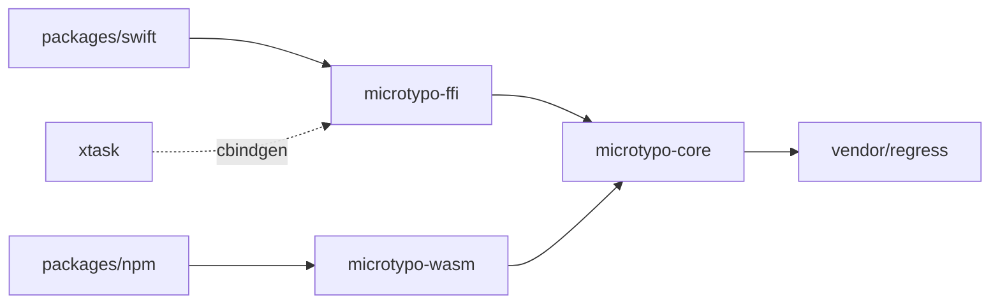

# Architecture

## Invariant

For any input and configuration, the engine returns the reference implementation's output, `changes` ranges and errors (`name`, `message`, `code`, `details`) byte for byte. `testdata/conformance/corpus.jsonl` holds the reference behaviour as cases; `corpus.sha256` pins its source commit and digest. The core and the npm package replay it in CI.

Known divergence: a lone surrogate quoted in a JSON-input error message is rendered as U+FFFD.

## Layout

| Part | Role |
|---|---|
| `crates/microtypo-core` | engine: rules, input formats, markup protection, budgets; no `unsafe` |
| `crates/microtypo-ffi` | C ABI, header in `include/microtypo.h`; the only workspace crate with `unsafe` |
| `crates/microtypo-wasm` | `wasm-bindgen` boundary |
| `packages/npm` | `@meritt/microtypo-wasm`: JavaScript API over the module |
| `packages/swift`, `Package.swift` | Swift package `MicroTypo` over the XCFramework |
| `vendor/regress` | ECMAScript regex engine over UTF-16 |
| `xtask` | header, builds, release set, corpus copy |

Bindings depend on the core and on nothing else.

## Core

- Each module mirrors the reference file of the same path in snake case; `src/lib/` maps to `shared`. Names and option spellings follow the reference, which is why the naming and size lints are relaxed in `Cargo.toml`.
- Text is `JsString` (UTF-16 code units). Lone surrogates survive; `changes` offsets are UTF-16 indices, as in JavaScript, `NSString` and `String.utf16`.
- `js` reproduces the JavaScript semantics the engine relies on: ECMAScript regexes via `vendor/regress` (non-`u` case folding, literal-unit prefilters), `JSON.parse`/`JSON.stringify` with V8 error messages, insertion-ordered config objects.
- One `Error` type; `ErrorKind` is `MicroTypoConfigError`, `MicroTypoInputError`, `MicroTypoBudgetError` or `TypeError`. Bindings map it without changing fields.
- Limits: `maxInputLength` (default 30 000 units) before processing, `maxProcessingMs` between stages, per-attempt bounds in backtracking scanners, `MAX_ENTRIES` (100 000) per vault. Inputs below these bounds keep every `usize`/`u32`/`f64` cast exact, hence the allowed `cast_*` lints.
- URLs, addresses, tokens and tags are vaulted behind placeholders carrying a nonce from the system CSPRNG. Without entropy the engine panics rather than mint a guessable nonce. Placeholder-shaped text is stripped on entry, and a custom rule group's output holds no placeholder token more often than its input.
- Effects: the clock (`Instant`, `js_sys::Date` on wasm) and the CSPRNG. The final binary picks the `getrandom` backend and the allocator.

## C ABI

- Text crosses as UTF-16 plus length; configuration and call arguments as UTF-8 JSON shaped like the JavaScript objects.
- A failing call returns `false` or `NULL` and, when `error` is not `NULL`, stores a `microtypo_error` there, freed with `microtypo_error_free`.
- Panics are caught and returned as `InternalError`, as is `NULL` for the engine or the method name. Other pointers follow each function's `Safety` contract.
- An engine is not thread-safe.
- Every `unsafe` block carries a `SAFETY` note; tests run under Miri without the `mimalloc` feature, which Miri cannot execute.
- `mimalloc` is on by default.

## WebAssembly package

- `cargo xtask wasm` builds with the `wasm` profile (`opt-level = "s"`), runs `wasm-bindgen --target web`, renames the glue's default module URL to `microtypo.wasm` so bundlers following `new URL(…, import.meta.url)` find it, and runs `wasm-opt -Os --strip-debug --strip-producers` (`-Oz` comes out larger). `dist` fails above 430 000 bytes of `gzip -9` (`WASM_GZIP_BUDGET`).
- `microtypo.js` exports only `load`. The glue holds one instance per realm: the first successful `load()` instantiates and later calls return the same API without reading their argument; a failed load is not kept. A module reporting another version stays in the glue, so every later `load()` in that realm rejects with `ERR_MICROTYPO_VERSION`. The export check before `initSync` keeps a module from another build out of the glue.
- `load()` calls `initSync` with a compiled module, never the streaming init; a `file:` URL is read with `node:fs`. `microtypo.js` targets Baseline Newly available and has no capability checks.
- `onCycleLimit` runs after the pass: JavaScript called mid-pass could reenter the engine.
- The JavaScript layer checks what only JavaScript values show (`undefined`, functions, symbols) and passes the rest to the engine as JSON.
- `packages/npm/pnpm-workspace.yaml` sets `minimumReleaseAge` and `trustPolicy`; `dist` copies it into the consumer that installs the packed tarball.

## Swift package

`Package.swift` sits at the repository root. A checkout with `packages/swift/MicroTypoFFI.xcframework` uses it; otherwise SwiftPM downloads the release XCFramework by the URL and checksum `cargo xtask pin` writes from the release set CI built. Headers live in a module-named folder so `module.modulemap` cannot collide with another XCFramework. `MicroTypo` serialises calls with `NSLock`, so one instance is shareable across threads. It checks values before `JSONSerialization`, which raises an uncatchable Objective-C exception on NaN, infinity or a non-JSON type. Deployment target: macOS 26.

## Reproducibility

- Pins: Rust in `rust-toolchain.toml`; the Miri nightly in CI and `AGENTS.md`; Node.js and pnpm in `devEngines` of `packages/npm/package.json` (read by `pnpm/setup`), pnpm also in `pnpm-lock.yaml`; `wasm-bindgen` exactly in `Cargo.toml`, its CLI version from `Cargo.lock`; binaryen 133, checked by `cargo xtask wasm`.
- CI installs cargo-deny, gitleaks, cargo-semver-checks, binaryen and `wasm-bindgen` as release binaries checked against a SHA-256 in the workflow; a `wasm-bindgen` bump needs the digest of its CLI.
- The XCFramework is built with `SOURCE_DATE_EPOCH` = 1980-01-01 (mimalloc embeds `__DATE__`/`__TIME__`) and zipped with sorted entries, fixed times and modes, and no extra fields, so two builds of one commit yield identical `SHA256SUMS`.
- `cargo-deny` checks licences, sources and advisories against `deny.toml`; Dependabot proposes action and crate updates weekly.
